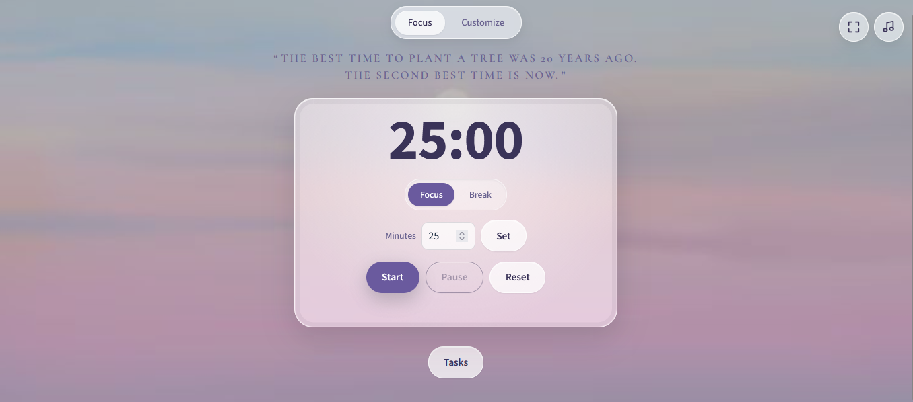

LOCK IN — Study With Me

> 🎯 "Focus on your goals. Stay consistent. Make progress."

Welcome to LOCK IN— a minimalist study-with-me website designed to help students stay focused, manage their study sessions, and build better study habits.

🌐 [Visit the Live Website](https://lsunjarnue-hash.github.io/Lock-in-Study-timer-/focus.html)

---
🖥️ Website Preview

 ✨ Features

 ⏱️ Focus Timer — Manage your study sessions and make every minute count.
 🎨 Customizable Background — Create your ideal study atmosphere with ambient colors.
 💬 Motivational Quotes — Find inspiration to keep moving toward your goals.
 🎧 Lofi Music — Enjoy a relaxing atmosphere while studying.
 📝 Task Setting— Define your study goals before starting a session.

 🎯 Project Purpose

LOCK IN is my very first personal frontend web development project that I am building as part of my learning journey.

Through this project, I aim to:

- 💻 Improve my HTML, CSS, and JavaScript skills.
- 🧠 Learn by building a practical, real-world project.
- 🚀 Create a simple and useful study tool for students.
- 🌱 Continuously improve my coding skills through practice.

 Built With

 🧱 HTML — Website structure
 🎨 CSS— Styling and layout
 ⚡ JavaScript — Interactive features

  Future Improvements

 ✨ Improve the user interface and user experience.
 🎯 Add more useful focus and productivity features.
 📚 Continue learning and applying new frontend development concepts.

> "Stay focused. Stay consistent. Lock in." 

⭐ "Built with curiosity, creativity, and a commitment to learning."
